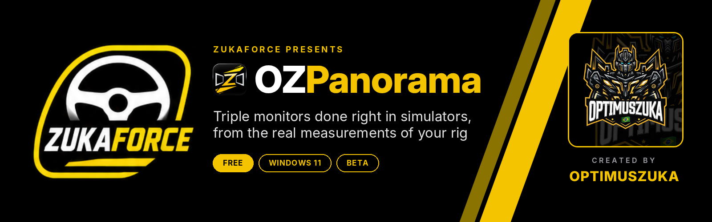
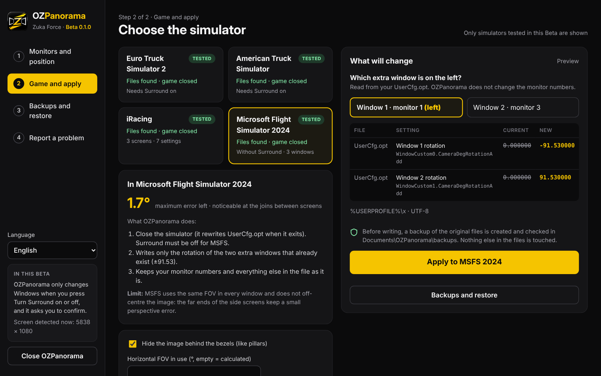
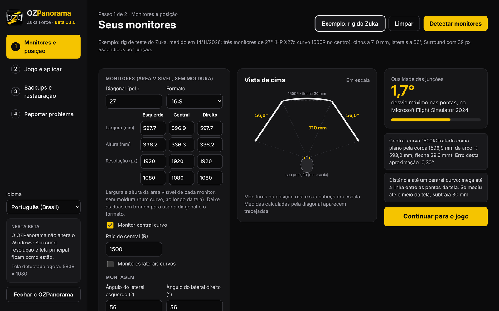

  

  
  
  
  
  

  <a href="../../releases"><b>⬇ Download the Beta</b></a> ·
  <a href="docs/LIMITATIONS.md">Known limitations</a> ·
  <a href="../../issues/new/choose">Report a problem</a>

---

## The problem

With three monitors, most simulators show a stretched or misaligned image at the joins: bent roads, objects that change
size when they move from one screen to the next. Fixing it by hand means working out angles, FOV and bezels, differently
for every game.

## The solution

**OZPanorama** does that maths from the real measurements of your rig (screen sizes, side angle, bezels and eye distance)
and **writes the right values into the game's files**, with a backup and a check.

  
   Beta 0.1 with the example rig: what will change in the MSFS 2024 file, current and new value, before applying.

  
   Monitor measurements, top view to scale with your head, and the quality of the joins.

> **Beta.** Try it first at a time when you can go back. Every change has a backup and can be restored inside the app.

## Simulators in this Beta

| Simulator | Status | What the app writes |
|---|---|---|
| Microsoft Flight Simulator 2024 | Tested (three monitors); two monitors experimental | Only the rotation of the extra windows that already exist in `UserCfg.opt` (two, or one with two monitors) |
| Euro Truck Simulator 2 | Tested (three monitors); two monitors experimental | `multimon_config.sii` and `r_multimon_mode "4"` in `config.cfg` |
| American Truck Simulator | Tested | Same as ETS2 |
| iRacing | Tested | 7 settings in `rendererDX11Monitor.ini` |
| RaceRoom Racing Experience | Tested | Triple screen settings in `graphics_options.xml` (distance, screen sizes, bezels, angles) |
| Assetto Corsa | Tested (with Content Manager) | `triple_screen.ini` (position of each screen) and `MODE=TRIPLE` in `video.ini` |
| Le Mans Ultimate | Tested | The three views (`SubViews=2`) and `ViewParams` / `LeftView` / `RightView` in `Config_DX11.ini` |

"Tested" means tested by the author on his own rig (three 27" monitors). Other rigs may behave differently:
use **Report a problem** in the app.

## What it does for you

- **Detect monitors**: reads each monitor's name and size, even with NVIDIA Surround on, and places them left / center / right.
- **Bezels**: calculated from the manufacturers' sheets for known monitors, with the **recommended NVIDIA bezel correction** in pixels (and a warning when the Surround hides a different amount).
- **Side angle**: enter the distance between the outer ends of the left and right monitors and the angle appears by itself.
- **Top view to scale**: your monitors and a head with real proportions, so you can see if it looks right.
- **NVIDIA Surround on/off with one click**: uses profiles saved by the NVIDIA driver itself, with confirmation.

## How to use

1. Download **OZPanorama_Setup.exe** from the Releases page (or the portable zip) and check the published SHA-256.
2. Run the installer (no administrator rights needed) and open OZPanorama from the Start menu. With the zip: extract it and open `OZPanorama.exe`.
3. **Monitors and position:** enter your measurements (or press "Detect monitors").
4. **Game and apply:** choose the simulator, check what will change and press Apply. The app creates and checks a backup and only then asks if you want to continue.
5. Close the game before applying: games rewrite their settings when they exit.

## Safety

- Writes only the settings listed above; the rest of the file, its encoding and line endings stay the same.
- Before writing: a checked backup in `Documents\OZPanorama\backups` (never deleted or overwritten).
- Atomic write, read-back and check; if anything fails, the originals are put back automatically.
- If the file changes between the preview and the write (by the game or another program), nothing is written.
- **Windows is only changed when you press Turn Surround on/off.** The app asks you to confirm and, with no answer in 20 s, puts back the previous setup. Resolution and the rest stay as they are.
- Sends nothing over the internet. "Report a problem" only opens GitHub with a text you have read and can edit.

## Windows SmartScreen and antivirus

`OZPanorama.exe` in this Beta has no digital signature. When you open it, Windows may show "Windows protected your PC".
Only continue (More info → Run anyway) if the zip came from the official Releases page and the SHA-256 matches.
Some antivirus programs distrust new unsigned programs; that does not prove the program is safe or unsafe.
The full source code is in this repository (`src/` and `app/`).

## Known limitations

See [docs/LIMITATIONS.md](docs/LIMITATIONS.md).

## Languages

English, Português (Brasil), Español and Français. The app picks the Windows language; you can change it in the side panel.

## For developers

- `build.cmd` builds `OZPanorama.exe` and `OZPanorama.Tests.exe` with the C# compiler that comes with Windows (.NET Framework 4.x). `build.cmd test` runs the tests of the write core.
- Interface and calculation tests: see [tests/README.md](tests/README.md).

---

Created by <b>OptimusZuka</b> · Zuka Force

